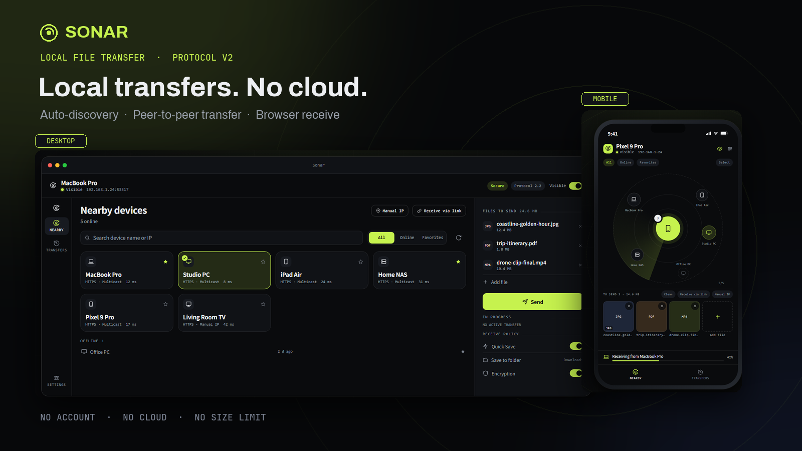

  

  <strong>Transfer files within your own local network.</strong> 
  No account, no cloud dependency, no file-size limit.

  <a href="https://www.zephyrqu.top/sonar/"><strong>Download</strong></a> ·
  Apache-2.0 · Flutter + Rust · protocol v2 (LocalSend-compatible) ·
  <a href="support/readme/README_ZH.md">中文</a>

---

Sonar is a personal fork of [LocalSend](https://localsend.org): it retains the upstream networking layer with a redesigned interface. Protocol v2 compatibility is preserved. Direct transfers with LocalSend devices on the same LAN are supported.

  

## Features

- Devices on the LAN are discovered automatically: nearby devices appear on a radar; others are listed for search.
- Files can be dropped onto a device, or a device can be selected first; multiple recipients can be queued.
- When the recipient has no app installed, enable *receive via link* and share the browser URL.
- All transfers use TLS with mutual certificate verification; device identity is derived from the certificate SHA-256 fingerprint.
- Auto-accept can be configured per device; favourites can be pinned for quick access; all transfers are recorded in a unified history.

## Platforms

Official builds are provided for Windows and Android; macOS, Linux, and iOS require building from source.
Installed apps can exchange files with one another; browsers can only receive files through *receive via link*.

Port `53317` (TCP and UDP) must be reachable on the LAN.

## Troubleshooting

- **No devices listed:** verify AP isolation, the Windows "Public" network profile, VPN interference, and Local Network permission on macOS/iOS. Manual peer IP entry remains available.
- **A specific pair fails:** port 53317 is blocked; for example, run `sudo ufw allow 53317`.
- **Low transfer speed:** use the 5 GHz band and disable encryption on both endpoints.

## About this fork

This is a personal, one-off redesign with a desktop-first interface, accessibility improvements, and no command-line interface. The networking crate (`packages/core`) continues to track upstream commit by commit. Protocol compatibility is maintained. Issues and pull requests may not receive a response.

## License

Apache-2.0. Original work © Tien Do Nam and the [LocalSend contributors](https://github.com/localsend/localsend/graphs/contributors);
redesign and derivative development © 2026 [Zephyr](https://github.com/zephyr-qu).
Bundled fonts are under the SIL Open Font License; see [NOTICE](NOTICE).
