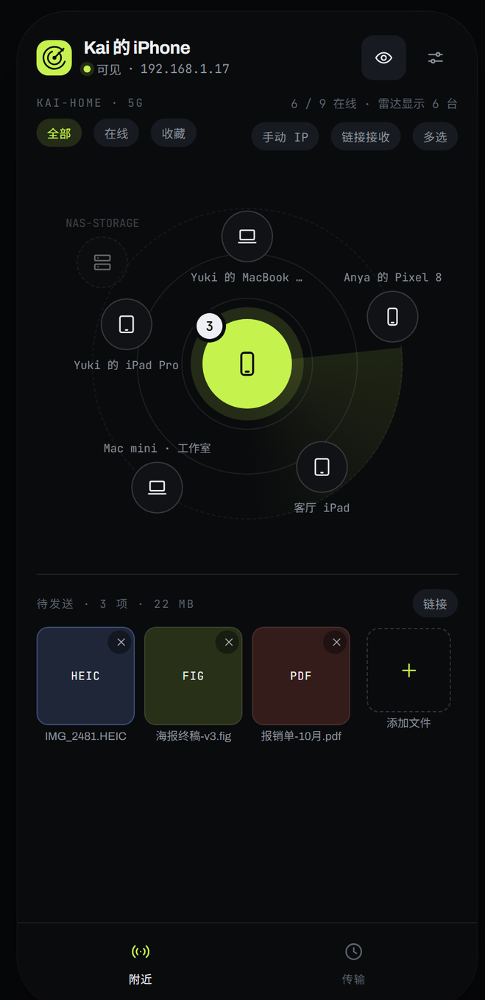

  

  <strong>在局域网内传输文件。</strong> 
  无需账号，不经过云端，不限大小。

  <a href="https://www.zephyrqu.top/sonar/"><strong>官网下载</strong></a> ·
  Apache-2.0 · Flutter + Rust · 协议 v2（兼容 LocalSend） ·
  <a href="../../README.md">English</a>

---

Sonar 是 [LocalSend](https://localsend.org) 的个人 fork：网络层沿用上游，界面重新做过。协议还是 LocalSend v2，所以能和同一网络里的 LocalSend 设备互传。

  

## 特性

- 同一网络的设备会自动出现：近的显示在雷达上，其他放进可搜索列表。
- 把文件拖到设备上，或者先选设备再挑文件；支持同时发给多台。
- 对方没装应用？开启「链接接收」，分享一个浏览器地址即可下载。
- 传输全程 TLS 加密、双向证书校验；身份以证书 SHA-256 为准。
- 可以指定设备自动接收，常用设备收藏后直连，收发记录都在同一个列表里。

## 平台

官网只提供 Windows、Android 安装包；macOS、Linux、iOS 需自行构建。装了应用的设备之间都能互传，浏览器只能收。

局域网需放行 `53317`（TCP 与 UDP）。

## 故障排查

- **找不到设备：** 检查路由器有没有开 AP 隔离、Windows 是不是「公用」网络、VPN 有没有拦截，以及 macOS/iOS 的「本地网络」权限。手动填对方 IP 仍然能用。
- **仅某对设备不通：** 端口 53317 被拦了，执行 `sudo ufw allow 53317` 放行。
- **传得慢：** 换 5 GHz，两端都关掉加密。

## 关于这个 fork

这是个个人项目，只做一次性的界面重设计，顺手修了无障碍和动效，砍掉 CLI，并提供 F-Droid 式构建。网络层（`packages/core`）会一个个提交跟着上游更新，界面（`app/`）不跟；协议保持兼容。issue 和 PR 可能不一定有人回。

## 许可

Apache-2.0。原始作品 © Tien Do Nam 与 [LocalSend 贡献者](https://github.com/localsend/localsend/graphs/contributors)；
重设计与修改 © 2026 [Zephyr](https://github.com/zephyr-qu)。
内置字体以 SIL Open Font License 授权，署名见 [NOTICE](../../NOTICE)。
