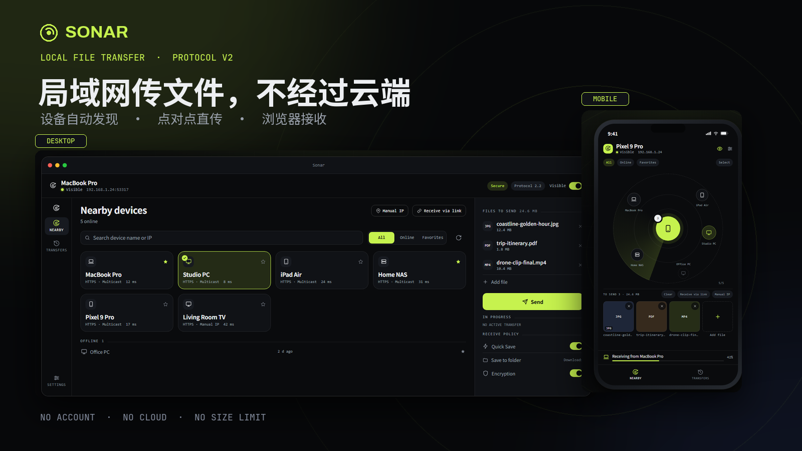

  

  <strong>局域网内点对点文件传输。</strong> 
  无需账号，不经云端，不限制文件大小。

  <a href="https://www.zephyrqu.top/sonar/"><strong>官网下载</strong></a> ·
  Apache-2.0 · Flutter + Rust · 协议 v2（兼容 LocalSend） ·
  <a href="../../README.md">English</a>

---

Sonar 是基于 [LocalSend](https://localsend.org) 的个人分支：网络层沿用上游实现，界面重新设计。协议保持 LocalSend v2 兼容。可与同一局域网内的 LocalSend 设备直接互传。

  

## 特性

- 同一局域网内的设备会自动发现：邻近设备显示在雷达视图中，其余设备列入可搜索列表。
- 可将文件拖放到目标设备，也可先选择设备再添加文件；支持向多台设备同时发送。
- 接收方未安装应用时，可启用「链接接收」并分享浏览器地址，对方通过浏览器即可下载。
- 传输过程采用 TLS 加密与双向证书校验；设备身份以证书 SHA-256 指纹为准。
- 可按设备配置自动接收，收藏常用设备以便快速选择，所有收发记录统一显示在传输列表中。

## 平台

官网仅提供 Windows 与 Android 安装包；macOS、Linux 和 iOS 需自行构建。已安装应用的设备之间可相互传输；浏览器仅支持接收。

局域网需放行 `53317`（TCP 与 UDP）。

## 故障排查

- **无法发现设备：** 请检查路由器是否启用 AP 隔离、Windows 网络配置是否为「公用」、VPN 是否造成拦截，以及 macOS/iOS 的「本地网络」权限。仍可通过手动输入对端 IP 建立连接。
- **仅特定设备间连接失败：** 端口 53317 可能被拦截，可执行 `sudo ufw allow 53317` 放行。
- **传输速率较低：** 建议使用 5 GHz 频段，并在两端关闭加密。

## 关于此分支

这是一个个人项目，进行一次性的界面重设计，并改进无障碍支持与动效，移除命令行界面。网络层（`packages/core`）持续按提交跟进上游。协议保持兼容。Issue 与 Pull Request 可能不会得到回复。

## 许可

Apache-2.0。原始作品 © Tien Do Nam 与 [LocalSend 贡献者](https://github.com/localsend/localsend/graphs/contributors)；
界面重设计与二次开发 © 2026 [Zephyr](https://github.com/zephyr-qu)。
内置字体依据 SIL Open Font License 授权，署名见 [NOTICE](../../NOTICE)。
